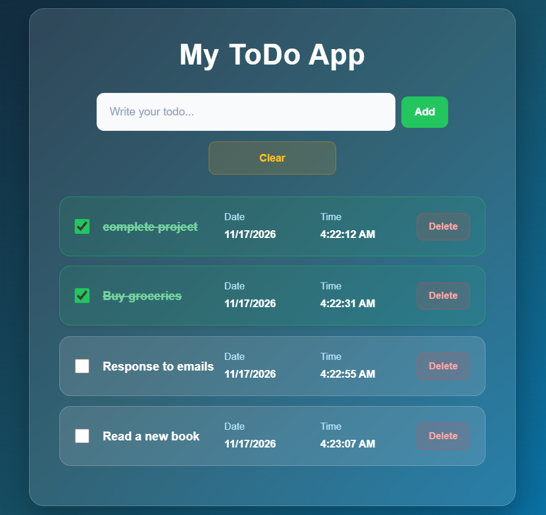

# React To-Do App

A simple and responsive To-Do List application built with React.js. I created this project to practice React fundamentals and improve my frontend development skills.

## Project Overview

This application helps users manage their daily tasks in one place. Users can add tasks, mark them as completed, delete individual tasks, and clear the entire task list.

I also added automatic date and time display for every new task.

## Live Demo

[React To-Do App](https://react-todo-app-eta-drab.vercel.app/)

## Screenshots

Here is a look at my project:



## Features

- Add new tasks
- Mark tasks as completed using checkboxes
- Automatically display task date and time
- Delete individual tasks
- Clear all tasks with one click
- Responsive layout for different screen sizes
- Simple and clean user interface

## Technologies Used

- React.js
- JavaScript
- HTML5
- CSS3
- Vite

## Getting Started

Follow these steps to run the project locally.

### 1. Clone the repository

```bash
git clone YOUR_GITHUB_REPOSITORY_URL
```

### 2. Open the project folder

```bash
cd react-todo-app
```

### 3. Install dependencies

```bash
npm install
```

### 4. Start the development server

```bash
npm run dev
```

Open the local URL shown in your terminal to use the application.

## What I Learned

While building this project, I got practical experience with:

- React functional components
- useState Hook
- Handling user events
- Rendering lists using map()
- Updating and deleting items using filter()
- Managing checkbox states
- Styling components with CSS
- Creating responsive layouts

## Author

**Mohammed Saqeeb**

Frontend Development Learner

GitHub: https://github.com/mohammed-saqeeb-786

---

This project is part of my journey in learning React.js and building practical frontend applications.
